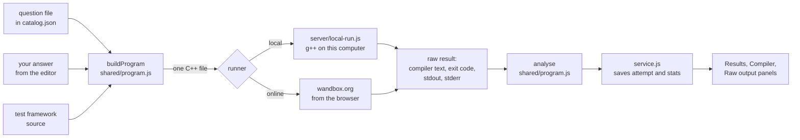

# Architecture

How the web app turns a question file and your answer into a result, and why it is built this way. Read this before changing `app/`, `framework/` or the question layout.

## Why it is shaped like this

The questions are C++ and must be compiled to be checked. The app has to work in two places: on a static website (GitHub Pages cannot run a compiler) and on your own machine with the real g++. So the app is split into a **browser app that does everything except compile**, and a **runner** that only compiles and runs one C++ file. Two runners exist, and either can be chosen at any time.

## Pipeline for one Run

## Components

| Part | Where | Job |
| --- | --- | --- |
| Question sets | `sets/<id>/` | Question files, solutions and `set.json`. See [question-format.md](question-format.md). |
| Test framework | `framework/` | Registers questions, runs tests, prints results and (when asked) structured events. |
| Catalog builder | `app/server/catalog.js`, `app/tools/build-catalog.js` | Reads every set and writes `catalog.json`: task text, provided code, starter code and the file split around the answer. No solutions. |
| Shared logic | `app/shared/` | `program.js` (build the program, analyse a result), `modes.js` (pick questions for each mode), `backup.js` (the backup file format, checks and merge rules), `questionset.js` (the user's manifest format), `pdfindex.js` (finds questions in a practice PDF) and `markup.js` (question text with maths). Plain JavaScript used by the browser, the server and the tools. |
| Browser app | `app/src/` | React views, the editor (Monaco), saved runs and stats (IndexedDB), question sets imported from the user's folders, the two runners. |
| Local server | `app/server/server.js`, `local-run.js` | Serves the built app and compiles with g++ on `POST /api/execute`. Binds to `127.0.0.1` only. |
| Tools | `app/tools/` | `verify.js` (check every solution and stub through the real pipeline). |
| CI | `.github/workflows/pages.yml` | Builds every question, runs the unit tests and `verify`, then publishes `app/dist` to GitHub Pages. |

## Mechanisms

### One self-contained C++ file

**Why it exists:** a remote compile service takes one source file, and a single file also removes the need for cached object files locally.

**What it does:** `buildProgram` takes the question file with the answer cut out (`before` and `after`), pastes your code between them, inlines the framework header where the question includes it, appends the framework source and a `main()` that calls `tf::RunQuestion(N)`.

**How `#line` keeps messages honest:** inlining would shift line numbers. `#line` directives restore the original file name and numbering after each inlined block, so g++ reports `q24_bst_remove.cpp:112:5` exactly as a normal build would. The app subtracts the answer's first line to get the editor line and draws the squiggle.

**Limitations:** every Run compiles the framework again (about half a second locally).

### Test events on stderr

**Why it exists:** the console output is for people. To draw a diff the app needs the expected and actual values as data, and parsing console text breaks when the student prints their own debug lines.

**What it does:** the generated file starts with `#define TF_EVENTS_STDERR`. With that defined, `framework/test_framework.cpp` writes one JSON object per event to stderr between the control characters `0x1E` and `0x1F`: `question`, `test_start`, `test_end` (with the failures and their expected/actual values). `analyse` pulls them out; whatever is left of stderr is the student's own.

**Why this approach:** a log file needs a path and an environment variable, which a remote service cannot provide. Control characters cannot appear in normal output. A normal build (CMake) does not define the macro and prints exactly what it always did.

**Crashes:** `test_start` is written before the test body runs, so a crash or timeout is attributed to the test that was running. Tests after it are reported as not run.

### Starter code comes from git HEAD

**Why it exists:** you practise by editing the stubs in the question files, so the working tree may hold your answers. The editor must always start from the pristine stub.

**What it does:** the catalog builder reads each question with `git show HEAD:<path>` and falls back to the working tree only when that fails (a new, uncommitted file). Set `CATALOG_SOURCE=worktree` to read the working tree instead, for example while writing a new question.

### Runners

- **Local** (`app/server/local-run.js`): writes the file to a temporary folder, runs `g++ -std=gnu++17 -Wall -Wextra -Wno-unused-parameter` (the same flags as CMake), runs the result with a 10 s limit, and deletes the folder. Up to 4 compiles run at once.
- **Online** (`app/src/lib/runners.js`): `POST https://wandbox.org/api/compile.json` from the browser with the newest g++ that Wandbox lists. A build counts as failed when the program printed nothing and the compiler text contains an error.

The server accepts requests only from its own page (`Host` and `Origin` are checked). It runs whatever C++ it is sent, so this blocks other websites and DNS-rebinding tricks from using it.

### Saved state

Runs and stats are stored in the browser's IndexedDB by `app/src/lib/service.js`. Typing updates a draft in memory and writes to disk at most every 400 ms. A run holds one draft and one last result per question. Stats are fixed-size counters per question, so storage stays bounded; deleting a run removes its drafts.

### Backups

Everything above lives only in one browser, so `app/src/lib/backup.js` can write all of it to one JSON file and read it back. The format, validation and merge rules are in `app/shared/backup.js`, so they are unit tested without a browser. Each IndexedDB store is described once in its `STORES` table (key field, shape check, how two copies of a record merge), and `state` holds each store's records under the store's own name. A new store (or a new set kind) is added to both and is then covered by backup and restore.

- **Merge** keeps the newer side of each record (runs by `updatedAt`, stats per question by `lastAt`). Counters are never summed, so a restore is repeatable.
- **Replace** clears the stores first. Both write every store in one IndexedDB transaction (`db.writeAll`), so a failure leaves the data as it was, and drop queued draft saves first so none lands afterwards.
- Settings are the whole of localStorage except the two reminder bookkeeping keys. The file has a `version`; a file from a newer version is refused, and older ones keep loading as stores are added.
- The page reloads after a restore, because theme, runner and shortcuts are read once at start-up.

### Your own question sets (library)

Besides the C++ sets in `catalog.json`, the app can show sets from folders on the user's computer, described in [question-set-format.md](question-set-format.md). A browser cannot keep a folder open between visits, and Firefox has no folder handles at all, so the plain folder chooser (`<input webkitdirectory>`, which works everywhere) reads the folder once and `app/src/lib/library.js` copies what it needs into IndexedDB.

- **Scan** (`scanFolder`): keeps only manifests, PDFs and images, parses each manifest with `app/shared/questionset.js`, resolves the files it names relative to the manifest's folder, and works out whether the set is new, changed or current. Nothing is stored yet, so the user sees problems before anything is copied.
- **Import** (`importSet`): one transaction per set writes the manifest to `libSets` and only the changed files to `libFiles` (key `<set id>/<path>`), and deletes files the set no longer names. A full disk aborts the transaction and leaves the earlier copy.
- **Indexing a PDF** (`indexPdf`, with `app/shared/pdfindex.js`): pdf.js reads every page's text and, on question pages, the drawing operators. The generated PDFs have a fixed layout, so header, title, footer and the dashed rule are found by position and font size (only text where the generator puts its own, because the slide content copied into each crop has text of its own that is clipped when drawn but still present in the text layer). The result is a manifest whose questions carry crops. `tools/index-pdf.js` runs the same code under Node and writes the manifest beside the PDF.
- **Viewing** (`app/src/lib/pdf.js`, `components/Question.jsx`): a PDF is read from IndexedDB into pdf.js (the last two stay open), and a crop is drawn by offsetting the page render. Typed text goes through `shared/markup.js` (a small Markdown subset with KaTeX, everything else escaped). pdf.js and its worker load only when a PDF is first needed.
- **Progress is separate from the copies.** `app/src/lib/practice.js` keeps, per question, the answers typed, the last check's result, how often it was right or wrong and the difficult flag (`libProgress`, key `<set id>/<uid>`), and the user's own corrections as an overlay on the question (`libEdits`: parts, marks, tags, crop box). Both are keyed by `uid`, so re-importing or re-indexing a set never touches them. `effectiveQuestions(set)` is the one place that lays the overlay over the imported questions; views read questions through it. The set's Stats page works its totals out of these records in `shared/libstats.js` (pure, unit tested), and its reset (`resetLibStats`) clears only the counters. These stores are in `STORES` in `shared/backup.js` and are backed up; `libSets` and `libFiles` are not, because they are copies of the user's folders.
- **Formula sheets** (`app/src/lib/formulas.js`): each set lists its sheets in `libFormulas`, and every sheet's file is its own copy in `libFiles` under `<set id>/formulas/`, so applying one sheet to several sets stores one copy per set (`addFormulaSheetsToSets`). `downloadSets` in `lib/backup.js` writes the chosen sets, with their sheets, as a "share" zip, and `restoreLibrary` brings the sheet files back with the sets.
- **Your own questions** (`app/src/lib/mine.js`, `components/AddQuestion.jsx`): one record in `libMine` holds a manifest and its images as data URLs, and `syncMine` shows it as the set `mine` beside the imported ones, so every view treats it the same. Unlike the library copies it has no folder to restore from, so `libMine` is in `STORES` and is backed up. The dialog crops a pasted or chosen image on a canvas (drag a box), scales it to 1400 px wide, and stores WebP (PNG where WebP is not available). uids come from the same SHA-1 of course, source and title as the PDF indexer, with `mine` as the course.
- **Practice sessions** (`libRuns`, `createLibRun` in `practice.js`, modes in `shared/librarymodes.js`): a session fixes its list of uids when it starts and records the current question. How a question went in a session is read from the progress record (`lastAt` since the session began), so a session stores no results of its own and abandoning it loses nothing.
- **Drawing hard questions more often** (`shared/weights.js`): `codingTrouble` and `libraryTrouble` turn the stats counters or progress record into 0 to 1, `weightOf` makes it a weight, and `weightedSample` (Efraimidis-Spirakis) draws without replacement. `pickQuestions` and `pickLibraryQuestions` take an optional weight function and behave exactly as before without one; the service layer passes it only when the Settings checkbox is on, and never stores it (a function cannot go into IndexedDB).
- **Checking answers** is `shared/answers.js` (number tolerance, choices, self marks). A check counts as an attempt only when no part is empty or invalid, and results and flags are written to IndexedDB at once while typed answers wait a moment, because the page may be left right after a check.
- **Database version:** the schema is version 3 (version 2 added the library stores, version 3 the progress stores). Upgrading only adds stores, so existing runs and stats are untouched. A page still open on the old version blocks the upgrade; the new page then says so instead of showing an empty app.

### Why React and Vite

The workspace has many panels that must stay in step (question list, editor, output, progress, stats). Hand-written DOM updates were the obvious place for bugs, so a component model pays for itself. React is the most widely documented choice, and Vite builds to plain static files, which is what GitHub Pages needs. Plain HTML and CSS would have worked for the first screen but not for this much shared state. TypeScript was left out to keep the project small; the shared logic is covered by unit tests instead.

## Limitations

- The coding sets are C++ only (`language: "cpp"`). A second language would need its own framework, `buildProgram` and runner. The user's own question sets (PDFs, screenshots, typed questions) have no code and no runner.
- The online runner depends on a free third-party service: it needs internet, may rate-limit, and receives your answer. The local runner has none of these limits.
- Progress is per browser and is not synced. A backup file moves it by hand.

## Practice PDFs: two-way sync

`app/src/lib/pdfsync.js` links an indexed set to its PDF file (File System Access API), re-indexes when the file changes, and writes changes back through `app/shared/pdfwrite.js` (pdf-lib): append a question in the indexer's layout, paint a replacement over a crop, remove pages. Every write is re-indexed straight away, so the manifest always comes from the PDF and `mergeIndex` keeps the uids that progress is filed under.
